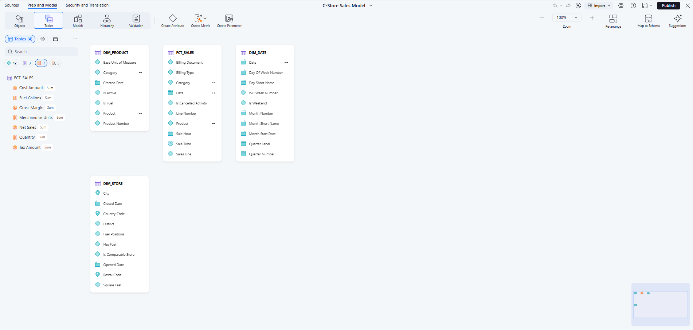
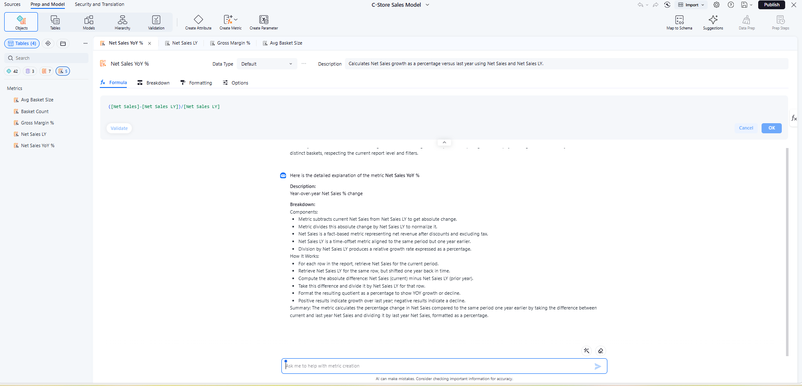
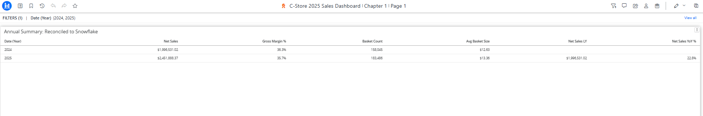
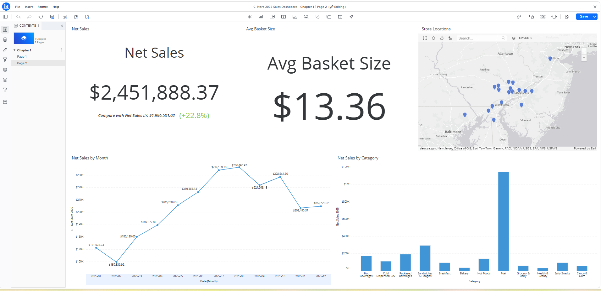

# Convenience Retail Analytics Pipeline

An end-to-end analytics engineering project for a fictional regional convenience store chain:
**SAP-style source data → Snowflake → dbt star schema → MicroStrategy semantic layer and dashboards.**

It mirrors a common enterprise pattern: migrating reporting off SAP ECC extracts onto a cloud
data platform, then rebuilding the BI semantic layer on clean, tested models.

> All data is synthetic, generated by `generate_sap_data.py`. No real company data is used.

## Architecture

```
generate_sap_data.py ──► Snowflake RAW_SAP ──► dbt staging ──► dbt marts (star schema) ──► MicroStrategy (Mosaic)
   (SAP-style CSVs)       (all VARCHAR)       (rename, cast,     fct_sales, dim_store,      attributes, facts,
                                               sign handling)     dim_product, dim_date      metrics, dashboards
```

## Source data

| SAP table | What it is | Grain | Rows (default) |
|---|---|---|---|
| `T001W` | Plants / stores | 1 per store | 20 |
| `ZSTORE_ATTR` | Custom store attributes (format, fuel, sq ft, open date) | 1 per store | 20 |
| `T023T` | Material group (category) text | 1 per category | 12 |
| `MARA` | Material master | 1 per product | 132 |
| `MAKT` | Material descriptions | 1 per product + language | 132 |
| `VBRK` | Billing document header | 1 per POS basket / return / cancellation | ~344K |
| `VBRP` | Billing document line item | 1 per basket line | ~671K |

Data covers 2024-01-01 through 2025-12-31 across 20 stores in PA, NJ, DE and MD, including fuel and
non-fuel formats. Built-in patterns: morning coffee and lunch hoagie peaks, hot vs. cold beverage
seasonality, monthly fuel price swings, 4% traffic growth, a 3% price increase each January,
three stores that open mid-period, and products that launch or are discontinued mid-period.

### Source quirks the staging layer handles

| Quirk | Where | Staging rule |
|---|---|---|
| Keys with leading zeros | `MATNR` (18), `VBELN` (10), `POSNR` (6) | Keep as strings for joins; strip zeros for display |
| `YYYYMMDD` date strings, `00000000` = null | `FKDAT`, `ERSDA`, `OPEN_DATE`, `CLOSE_DATE` | `TRY_TO_DATE(NULLIF(col, '00000000'), 'YYYYMMDD')` |
| `HHMMSS` time strings | `ERZET` | `TRY_TO_TIME(col, 'HH24MISS')` |
| Document type sets the sign | `FKART`: `ZPOS` sale, `ZRET` return, `S1` cancellation | Amounts stored positive; multiply `ZRET` and `S1` by -1 |
| Cancelled originals | `VBRK.FKSTO = 'X'`, `S1.SFAKN` points to original | Either keep both (they net to zero) or drop both; document the choice |
| Discontinued products | `MARA.LVORM = 'X'` | Flag as inactive in `dim_product`, keep history |
| Units of measure | `GAL` for fuel, `EA` for everything else | Keep fuel gallons and merchandise units in separate measures |

## How to run

```bash
python generate_sap_data.py            # writes ~/sap_raw/*.csv (~80 MB, ~10 seconds)
python generate_sap_data.py --out data # or choose another folder
python generate_sap_data.py --help     # date range, volume, seed options
```

Then run `load_raw_sap.sql` in a Snowflake worksheet to create the RAW_SAP tables and load the files.
The output is repeatable: the same `--seed` always produces the same data.

## dbt models

```
cstore_dbt/models/
├── staging/sap/        one view per SAP table: rename, cast, filter client and language
├── intermediate/       int_sales_lines__signed: lines joined to headers, return/cancel signs applied
└── marts/              star schema: fct_sales, dim_store, dim_product, dim_date
```

| Model | Grain | Notes |
|---|---|---|
| `fct_sales` | Billing document line | Signed measures: net sales, cost, gross margin, tax, fuel gallons, merchandise units |
| `dim_store` | Store | Location, district, format, fuel, square feet, comparable-store flag |
| `dim_product` | Product | Name, category, fuel flag, active flag |
| `dim_date` | Calendar day | Year, quarter, month, ISO week, weekday, same day last year |

**Data tests:** keys are unique and not null, every fact row joins to each dimension, document
types are valid, and two custom tests check that billing header totals match their line items and
that cancelled sales net to $0 against their S1 reversals.

### Running dbt

```powershell
py -m venv .venv
.venv\Scripts\Activate.ps1
python -m pip install dbt-core dbt-snowflake
python setup_snowflake_key.py --user <SNOWFLAKE_USER>   # key-pair login; run the printed ALTER USER in Snowflake
# copy cstore_dbt/profiles.example.yml to ~/.dbt/profiles.yml and set the account
cd cstore_dbt
dbt debug        # check the connection
dbt build        # run all models and tests
dbt docs generate; dbt docs serve   # browse model docs and lineage
```

## MicroStrategy (Strategy Mosaic) semantic layer

The dbt marts are modeled in a Strategy One **Mosaic model** (`C-Store Sales Model`), connected
to Snowflake through a dedicated read-only login (`MSTR_READER` / role `BI_READER`, see
`bi_reader_setup.sql`) that can only `SELECT` from `CSTORE.MARTS`.



**Schema objects.** The auto-generated draft model was reviewed and corrected:

| Fix | Why |
|---|---|
| Mapped the **Date** attribute ID to `DIM_DATE.DATE_DAY` *and* `FCT_SALES.SALE_DATE` (heterogeneous column mapping) | The auto-modeler created two unrelated date attributes, so sales could not be analyzed by month or year |
| Added DESC forms (`STORE_NAME`, `PRODUCT_NAME`, `CATEGORY_NAME`) and set them as display forms; removed the duplicate name attributes | Reports show names instead of codes, with one object per business concept |
| Converted `Square Feet` and `Fuel Positions` from metrics to attributes | They describe a store; summing them across sales rows is meaningless |
| Enabled time attributes on Date (Day, Week, Month, Quarter, Year) | Provides the date hierarchy and powers time-series functions |
| Set base metrics to decimal data types and currency/number formats | Reconciliation found a 1¢ floating-point drift with the default `Double` type |

**Business metrics**

| Metric | Formula | Type |
|---|---|---|
| Gross Margin % | `[Gross Margin] / [Net Sales]` | Compound (ratio of totals, correct at any level) |
| Basket Count | `Count<Distinct=True>([Billing Document])`, condition: Transaction Type = Sale AND Is Cancelled Activity = 0 | Conditional |
| Avg Basket Size | `[Net Sales] / [Basket Count]` | Compound |
| Net Sales LY | `PreviousYear([Date]@ID, 1, [Net Sales])` | Time-series |
| Net Sales YoY % | `([Net Sales] - [Net Sales LY]) / [Net Sales LY]` | Compound |



## Reconciliation

Strategy totals were checked against Snowflake with `reconciliation.sql` and match exactly:

| Year | Net Sales | Gross Margin % | Basket Count | Avg Basket Size | Net Sales LY | YoY % |
|---|---|---|---|---|---|---|
| 2024 | $1,996,531.03 | 36.3% | 158,045 | $12.63 | | |
| 2025 | $2,451,888.37 | 35.7% | 183,486 | $13.36 | $1,996,531.03 | 22.8% |



## Dashboard

KPI cards (with prior-year comparison), monthly net sales vs. last year, and sales by category,
filtered by year.



## Roadmap

- [x] Synthetic SAP-style source data
- [x] Raw load into Snowflake
- [x] dbt staging models with source tests
- [x] dbt marts: `fct_sales`, `dim_store`, `dim_product`, `dim_date`
- [x] dbt tests (unique, not_null, relationships) and docs/lineage
- [ ] GitHub Actions CI running `dbt build` on every pull request
- [x] MicroStrategy semantic layer: attributes, conditional/compound/time-series metrics, dashboard
- [ ] MicroStrategy prompted report and weekly subscription
- [x] SQL reconciliation of MicroStrategy totals against Snowflake
